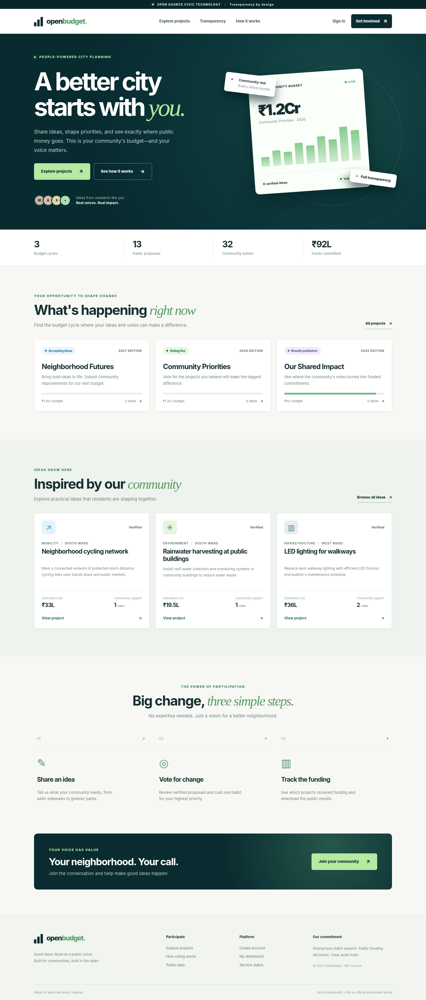
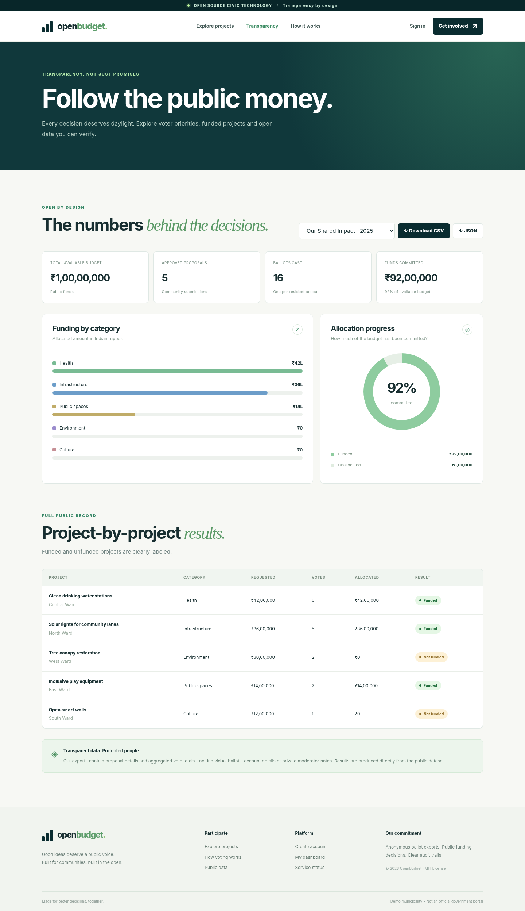
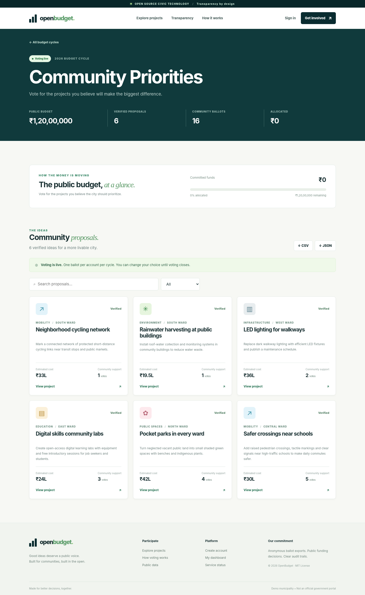
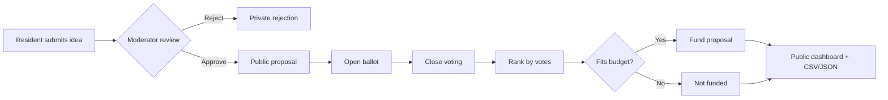

<div align="center">

# 🏛️ OpenBudget
### Your city. Your voice. Your budget.

**An open-source participatory budgeting platform for community-led decisions.**

[](https://www.python.org/)
[](https://sqlite.org/)
[](LICENSE)
[](#technology-stack)

*Propose improvements · Verify ideas · Vote for priorities · Publish budget decisions*

</div>

---

## ✨ What it does

OpenBudget brings residents and moderators into the same transparent budgeting workflow, from idea submission to published funding decisions.

| Module | Capabilities |
|---|---|
| 👥 Citizen portal | Registration, secure sign-in, personal dashboard |
| 💡 Idea submission | Public-service proposals with ward, category and estimated INR cost |
| 🛡️ Review desk | Moderator-only approval/rejection, notes, activity log |
| 🗳️ Public voting | One ballot per account per budget cycle; change vote before closure |
| 💰 Budget allocation | Deterministic vote ranking and budget-safe project selection |
| 📊 Transparency | Real-time totals, category distribution, project-level funding |
| 📦 Open datasets | Public CSV and JSON downloads with aggregate ballots and no personal voter data |
| 📱 Responsive design | Custom mobile-first styling, semantic controls, no frontend build step |
| ✅ Tests | Automated integration tests using real HTTP requests against a test SQLite database |

> **Scope:** This is a functional demonstration. Account-based voting is **not** government-verified one-person-one-vote. See [SECURITY.md](SECURITY.md) before using it with real citizens.

## 📸 Interface preview



<details><summary><strong>See the transparency dashboard and voting interface</strong></summary>





</details>

## 🖥️ Screens and interactions

- **Home:** Community budget highlights, current cycles, proposal discovery, impact counters.
- **Explore:** Budget editions and public proposals.
- **Cycle detail:** Verified proposals, voting status, totals and public exports.
- **Proposal detail:** Description, estimate, category, ward and ballot action.
- **Submit:** Citizen proposal form with server-side verification.
- **My dashboard:** All your proposals, including private review states.
- **Transparency:** Allocation progress ring, category comparison and export table.
- **Moderation:** Create a budget cycle, review pending proposals, advance phases and inspect the audit feed.

The UI is entirely local and does not load icon fonts, chart scripts, or data from a third-party CDN.

## 🚀 Quick start

**Requires Python 3.10 or newer. No `pip install` is necessary.**

```bash
# Clone your copy of the repository
git clone https://github.com/YOUR-USERNAME/OpenBudget.git
cd OpenBudget

# Initialize the database and populate sample cycles + accounts
python manage.py seed

# Launch the web server
python manage.py serve
```

Visit **http://127.0.0.1:8000**.

To start with an empty database instead:

```bash
python manage.py init
python manage.py serve
```

The seed command is idempotent: it does not duplicate sample data. Demo data is added only when you explicitly run `seed` on a database with no cycles. For a clean reset, stop the server and remove `data/openbudget.sqlite3` (and accompanying SQLite WAL/SHM files) before seeding again.

### Demo accounts

| Role | Email | Password |
|---|---|---|
| Citizen | `mira@demo.local` | `DemoPass123!` |
| Moderator | `moderator@demo.local` | `DemoPass123!` |

**⚠️ These credentials are intentionally public demonstration accounts. Never seed them into a real public deployment.** Additional demo citizen accounts populate sample vote counts. Anyone can register a new citizen account while the server is running.

### Running with Docker

```bash
# Persist database files under ./data
docker compose up --build -d

# On a fresh Docker database, add the sample cycles once
docker compose exec openbudget python manage.py seed
```

Visit **http://localhost:8000**. Use a TLS reverse proxy before exposing the service to the public internet.

### Automated tests

```bash
python -m unittest discover -s tests -v
```

The integration tests create a disposable database and exercise authentication, CSRF, permissions, proposal submissions, approvals, vote replacement, allocation, budget safeguards and exports. A GitHub Actions workflow runs them on Python 3.10, 3.12 and 3.13.

## 🏗️ Technology stack

| Layer | Tooling |
|---|---|
| Server | Python 3 standard library `http.server` |
| Database | SQLite, `sqlite3` (WAL enabled) |
| UI | HTML5, modern CSS3, vanilla JavaScript |
| Authentication | Server-side sessions, PBKDF2 password hashing, CSRF checks |
| Visualization | CSS bar/ring charts (no charting dependency) |
| Tests | `unittest`, `urllib.request` HTTP integration |
| Container | Python 3.12 slim with mounted SQLite data directory |

### Project layout

```text
OpenBudget/
├── manage.py                 # init / seed / serve CLI
├── openbudget/
│   ├── app.py                # HTTP routes, business logic, exports
│   ├── db.py                 # SQLite schema and audit utilities
│   ├── security.py           # password/session helpers
│   └── seed.py               # 3 sample budget cycles + demo users
├── static/
│   ├── index.html            # app shell
│   ├── app.js                # client-side pages and actions
│   ├── styles.css            # responsive visual system
│   └── favicon.svg
├── tests/test_openbudget.py  # end-to-end integration tests
├── data/                     # local SQLite database (gitignored)
├── .github/workflows/ci.yml
├── Dockerfile
├── docker-compose.yml
├── SECURITY.md
└── LICENSE
```

## 🔄 Workflow



**Budget cycle stages** (forward only): `submissions` → `voting` → `closed` → `allocated`.

Moderators can create new cycles (which begin in the submission phase) and change stages in their workspace. While accepting submissions, they can approve or reject pending proposals. In the voting stage, registered accounts cast or change one ballot. After closure, a moderator finalizes funding. The budget algorithm ranks approved proposals by vote count descending, ties by ID ascending. It walks the ranking once, funding each positively voted proposal that fits within the remaining budget. It does not split project requests or optimize combinatorial allocations. Once allocated, final results cannot be changed through the API.

## 🌐 Selected HTTP endpoints

| Method | Endpoint | Access |
|---|---|---|
| GET | `/api/health` | Public |
| GET | `/api/session` | Public; returns CSRF token |
| POST | `/api/auth/register` | Public (with guest session + CSRF) |
| POST | `/api/auth/login` | Public (with guest session + CSRF) |
| POST | `/api/auth/logout` | Signed-in |
| GET | `/api/bootstrap` | Public |
| GET | `/api/cycles/{slug}` | Public |
| POST | `/api/cycles/{slug}/proposals` | Signed-in; during submissions |
| GET | `/api/proposals/{id}` | Public if approved; owner/moderator otherwise |
| POST | `/api/proposals/{id}/vote` | Signed-in; during voting |
| GET | `/api/me/proposals` | Signed-in |
| GET | `/api/transparency?cycle={slug}` | Public |
| GET | `/api/cycles/{slug}/export.csv` | Public |
| GET | `/api/cycles/{slug}/export.json` | Public |
| POST | `/api/admin/cycles` | Moderator; create budget cycle |
| GET | `/api/admin/queue` | Moderator |
| POST | `/api/admin/proposals/{id}/moderate` | Moderator |
| POST | `/api/admin/cycles/{id}/transition` | Moderator |
| GET | `/api/admin/audit` | Moderator |

Every POST must provide `Content-Type: application/json` and the `X-CSRF-Token` returned by `/api/session`. Requests must include the `ob_session` cookie.

### Open-data example

```json
{
  "proposal_id": 1,
  "cycle": "Our Shared Impact",
  "title": "Clean drinking water stations",
  "category": "Health",
  "ward": "Central Ward",
  "status": "funded",
  "requested_inr": 4200000,
  "votes": 6,
  "allocated_inr": 4200000
}
```

Public records expose aggregate counts; they do **not** include individual voters, names/emails, or private review notes. The downloadable CSV uses these columns; this JSON snippet illustrates the equivalent project record. The actual JSON API uses `requested_amount`, `allocated_amount`, `district`, etc.

## 🧭 Roadmap ideas

- Resident ID / eligibility verification, OTP and anti-bot safeguards.
- District-based ballot restrictions and multilingual localization.
- Uploads, geospatial project locations and GIS maps.
- Project milestone tracking, receipts and public implementation updates.
- Independent reviewer workflow and appeal management.
- Postgres migration and horizontally scalable deployment.

## 🤝 Contributing

Fork the project, add your changes, run the test suite and open a pull request. See the [security guide](SECURITY.md) for responsible deployment limitations.

**License:** [MIT](LICENSE). Seeded sample projects, budgets, locations and accounts are fictional.
